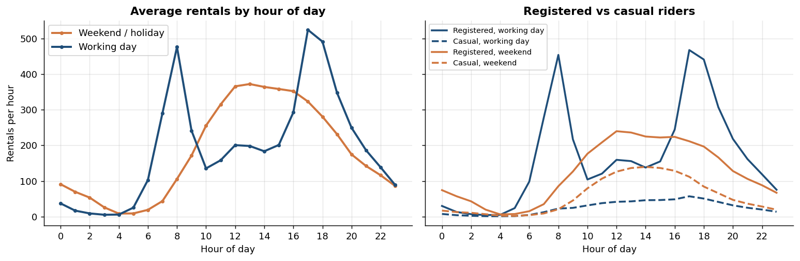
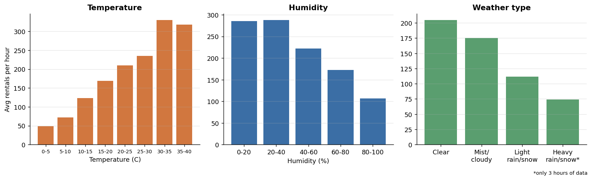
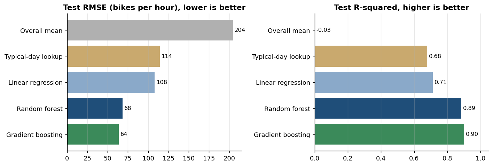
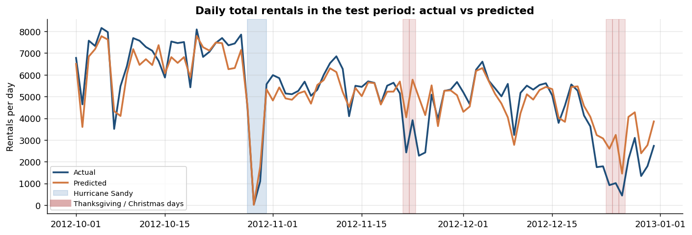
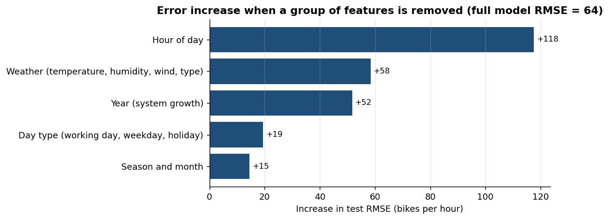

### What Drives Bike-Share Demand? Exploratory Analysis and a Baseline Forecasting Model

**Author:** Amit Kumar Ray

#### Executive summary

Using two years of Capital Bikeshare data (17,379 hourly records, Washington D.C., 2011-2012), this project finds out which factors drive demand for shared bikes and builds a baseline model that forecasts hourly rentals. A gradient-boosting model, tested on three months of data it had never seen (October-December 2012), predicts hourly demand with a typical error of **39 bikes per hour (18% of average demand)** and explains **90% of the variation (R² = 0.90)**. That is about 45% less average error than a simple "typical day" lookup table.

The main findings:

1. **Time of day matters most.** Working days have two commuter peaks (about 480 rentals/hour at 08:00 and 525 at 17:00); weekends have one afternoon hump (about 370 at 13:00).
2. **Weather is second.** Rain or snow cuts demand by almost half; demand climbs steadily with temperature and falls when humidity is high.
3. **The system is growing fast** (+63% from 2011 to 2012) and demand is strongly seasonal (winter is about half of summer).
4. **The biggest forecasting errors are holidays, not hurricanes.** The model handled Hurricane Sandy well but badly over-predicted Thanksgiving weekend and Christmas week.

A short Word summary of the findings is in [`Capstone_20.1_Summary_of_Findings.docx`](Capstone_20.1_Summary_of_Findings.docx).

#### Rationale

A bike-share operator has to put the right number of bikes in the right place at the right time. Too few bikes means lost rentals and unhappy riders; too many means idle bikes and rebalancing trucks driving around for nothing. A model that forecasts demand from the calendar and the weather forecast can drive rebalancing, staffing and maintenance schedules, and knowing which factors drive demand shows planners when maintenance is cheap and which weather conditions need a contingency plan.

#### Research Question

How much of the hourly demand for shared bikes can be explained and predicted from the time of day, the calendar and the weather, and which of those factors matter most?

#### Data Sources

The UCI Machine Learning Repository **Bike Sharing Dataset** ([link](https://archive.ics.uci.edu/dataset/275/bike+sharing+dataset)), built from Capital Bikeshare trip logs for 2011-2012 with weather and holiday information added.

* `data/hour.csv`: 17,379 hourly records (used for modelling)
* `data/day.csv`: 731 daily records (used for the long-term view and anomaly check)
* Features: hour, month, season, year, weekday, working day, holiday, weather type, temperature, humidity, wind speed. Target: `cnt`, the total number of rentals in the hour.

Citation (required by the data licence): Fanaee-T, H. and Gama, J. (2013). *Event labeling combining ensemble detectors and background knowledge.* Progress in Artificial Intelligence, 1-15. doi:10.1007/s13748-013-0040-3

#### Methodology

The notebook follows these steps:

1. **Data quality and cleaning.** No NaN values or duplicates. Fixed: 22 hours of impossible 0% humidity (one sensor day) were imputed by linear interpolation; the codebook's `season` labels were wrong (season 1 is winter) and were relabelled. Kept as is, with reasons: 165 hours absent from the file (mostly overnight hours with no rentals), wind speed recorded as 0 in 12.5% of hours, and 3 hours of heavy rain/snow.
2. **Exploratory data analysis.** Demand distribution, growth and seasonality, hourly patterns by day type, weather effects, correlations, holidays.
3. **Outlier analysis.** Tukey (1.5 × IQR) checks on demand and weather, and a robust-z-score check of daily demand. It flags 13 abnormally quiet days (Hurricane Sandy, Thanksgiving and Christmas periods, storm days). They are real events, so they were kept.
4. **Feature engineering.** New variables built from the raw columns: `hr_sin` and `hr_cos` (cyclical hour), `is_weekend`, and `commute_hour` (working-day rush hours). `casual` and `registered` are excluded because they add up to the target (leakage); `atemp` is dropped because it is 0.99 correlated with `temp`.
5. **Time-based train/test split.** Train on everything before 1 October 2012 (21 months), test on October-December 2012. A random split would leak information between neighbouring hours and give overly optimistic scores. Tuning uses forward-chaining `TimeSeriesSplit` cross-validation inside the training period only.
6. **Models**, from simple to complex: overall mean, "typical day" lookup (hour × day type × year), linear regression, random forest, gradient boosting.
7. **Evaluation metric.** **RMSE** (in bikes per hour) is the primary metric: it is in the units of the problem and punishes large misses, which are the costly ones for an operator. MAE, R² and RMSLE are reported alongside it (see the notebook for the rationale).
8. **Error analysis** by hour and by day, a grouped feature-importance check, and a check that the engineered features help.

#### Results

Test period: October-December 2012 (2,168 hours, never used for training or tuning).

| Model | RMSE | MAE | R² |
|---|---|---|---|
| Overall mean | 204 | 157 | -0.03 |
| Typical-day lookup (hour × day type × year) | 114 | 72 | 0.68 |
| Linear regression | 108 | 79 | 0.71 |
| Random forest | 68 | 43 | 0.89 |
| **Gradient boosting (baseline to carry forward)** | **64** | **39** | **0.90** |

RMSE and MAE are in bikes per hour (average demand in the test period is 219). 74% of hours are predicted to within 50 rentals. The best RMSE is 44% below the lookup table's.







**Feature engineering helped:** it cut the linear model's RMSE from 122 to 108 and the gradient-boosting model's from 66 to 64.

**What the model gets wrong.** Errors are largest in commute peaks (MAE about 81 vs 33 in other hours). Seven of the eight largest daily errors are over-predictions on Thanksgiving weekend and around Christmas, because the data only flags the official holiday and codes the quiet days around it as ordinary days. Hurricane Sandy (29 October: 22 actual vs 15 predicted rentals) was captured by the wind and rain variables.



**What the model relies on.** Removing hour of day drops R² from 0.90 to 0.19; removing weather raises RMSE by 58, year (growth) by 52, day type by 19 and season/month by 15.



**Recommendations for an operator:** rebalance before the commute peaks; link the forecast to the weather forecast; handle holiday periods manually until the model improves; re-train regularly because of the growth.

**Limitations:** two years from one city and a single three-month test window; the model uses observed weather (real use would use forecasts, so accuracy would be somewhat lower); system-wide totals cannot say where bikes should go; findings are associations, not causes.

#### Next steps

1. Add a holiday-period feature (days around Thanksgiving, Christmas etc.) and test whether it fixes the largest errors.
2. Add recent-demand features (same hour yesterday or last week) and an explicit trend to deal with growth.
3. Model casual and registered riders separately; their patterns differ clearly.
4. Validate across several time windows covering all seasons and add prediction intervals.
5. Try a Poisson loss and further tuning; tidy the code and write a non-technical summary.

#### Outline of project

- [Notebook: initial report, EDA and baseline model](bike_sharing_demand_eda.ipynb)
- [Word summary of findings](Capstone_20.1_Summary_of_Findings.docx)

```
bike-sharing-capstone/
├── README.md
├── Capstone_20.1_Summary_of_Findings.docx   # Word summary with link to the notebook
├── bike_sharing_demand_eda.ipynb            # full analysis with executed outputs
├── requirements.txt
├── data/
│   ├── hour.csv                             # hourly data (modelling)
│   └── day.csv                              # daily data (long-term view, anomaly check)
└── images/                                  # figures produced by the notebook
```

**How to run:** Python 3.9+ with the packages in `requirements.txt` (`pip install -r requirements.txt`). Open the notebook from the repository root so that `data/` is found, and run all cells (about 3 minutes, mostly for the grid searches).

##### Contact and Further Information

Amit Kumar Ray - add your email or LinkedIn link here.
